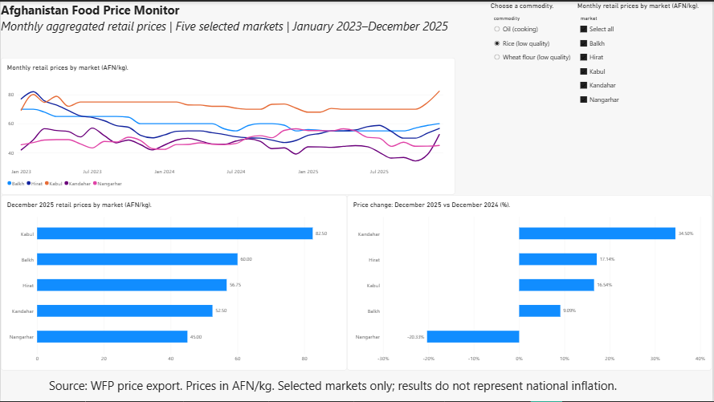

# Afghanistan Food Price Monitor

An analysis of staple-food prices across five Afghan markets,
using Python, MySQL, Excel, and Power BI.

## Project question
How did prices of selected staple foods change across markets
between January 2023 and December 2025?

## Data and scope
- Source: WFP Afghanistan price export.
- Downloaded: 11 November 2026.
- Markets: Balkh, Hirat, Kabul, Kandahar, and Nangarhar.
- Commodities: low-quality rice, low-quality wheat flour,
  and cooking oil.
- 540 monthly observations covering 36 months.
- Aggregated retail prices in AFN/kg; forecast records excluded.
- The original source export is not included in this repository. To reproduce the analysis, obtain an export from the linked WFP dashboard using the scope described in the reproduction guide.

## Key findings
- Rice prices increased 25.41% in Kandahar and 18.97% in Kabul
  between January 2023 and December 2025.
- December 2025 rice prices ranged from 45.00 AFN/kg in
  Nangarhar to 82.50 AFN/kg in Kabul.
- Kandahar rice prices rose 35.78% between November and
  December 2025, making the final-month movement important
  when interpreting its overall increase.
- Wheat flour prices fell 40.30% in Balkh over the study period.

## Workflow
1. Python: inspect, filter, validate, and visualize source data.
2. MySQL: store observations and calculate price changes.
3. Excel: independently check selected calculations.
4. Power BI: build interactive market and commodity comparisons.

## Dashboard
The report includes:
- Monthly price trends.
- Latest prices by market.
- Year-over-year price changes.
- Detailed prices and monthly changes.
- Data checks, methodology, and findings.

[View the report PDF](reports/afghanistan_food_price_monitor.pdf)

## Project structure

    raw_data/         Original source export
    data_processed/   Clean data and dashboard input
    python/           Inspection, preparation, and plotting scripts
    sql/              Database, validation, and analysis scripts
    excel/            Independent calculation checks
    powerbi/          Power BI report
    docs/             Methods and supporting documentation
    reports/          Charts, screenshot, and report PDF

## Documentation
- [Project summary](docs/project_summary.md)
- [Data dictionary](docs/data_dictionary.md)
- [Power BI measures](docs/power_bi_measures.md)
- [Reproduction guide](docs/reproduction_guide.md)

## Quality checks
Validated unique monthly keys, complete coverage, positive prices,
and expected missing comparisons. Selected calculations matched
across SQL, Excel, and Power BI. Dashboard filters and PDF checked.

## Limitations
These results cover selected markets and commodities. They do not
represent national inflation or measure household affordability.
The analysis does not establish the causes of price changes.

## Source
[WFP Afghanistan price dashboard](https://dataviz.vam.wfp.org/asia-and-the-pacific/afghanistan/economic/prices)
